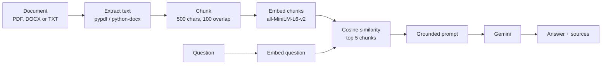

# AI Research Assistant

Upload a document (PDF, Word or text), ask a question, and get an answer that comes **only from the document**, with the source passages and similarity scores shown underneath.

This is a RAG (retrieval-augmented generation) project built in Python: it finds the most relevant parts of a document with sentence embeddings, then asks Gemini to answer using only those parts.

**Demo video:** [Watch the 90-second demo](ADD-YOUR-VIDEO-LINK-HERE)


---

## What it does

- Reads text-based PDFs, Word (`.docx`) files and plain-text (`.txt`) files, and splits the text into overlapping chunks
- Turns every chunk into a 384-dimension vector with `sentence-transformers`
- Finds the chunks closest in meaning to your question using cosine similarity
- Sends only those chunks to Gemini, with instructions to answer from them and to say so when the document doesn't contain the answer
- Shows the answer together with the passages it was based on, so every answer can be checked

If you ask something the document doesn't cover, the app says it cannot find the answer instead of guessing.

## How it works



| Step | What happens | Function (`rag.py`) |
|---|---|---|
| 1. Extract | Read the text from a PDF, DOCX or TXT file, choosing the reader by file type. A damaged PDF, or a scanned PDF with almost no real text, is rejected with a clear message. | `extract_text` |
| 2. Chunk | Split into 500-character pieces that overlap by 100, so a sentence cut at a boundary still appears whole in one chunk. | `chunk_text` |
| 3. Embed | Convert each chunk to a vector with `all-MiniLM-L6-v2`. The model loads lazily and is reused. | `embed_chunks` |
| 4. Retrieve | Embed the question and rank chunks by cosine similarity. | `retrieve` |
| 5. Prompt | Build a prompt that tells the model to use only the supplied context and not to invent facts. | `build_prompt` |
| 6. Generate | Call Gemini and return the answer. Temporary server errors are retried with backoff. | `generate_answer` |

## Tech stack

- **Python 3.12**
- **pypdf** and **python-docx** for reading documents
- **sentence-transformers** (`all-MiniLM-L6-v2`) for embeddings
- **Google Gemini** (`google-genai`) for answer generation
- **Streamlit** for the demo interface
- **FastAPI** for a REST API version of the same pipeline

## Project structure

```
ai-service/
├── rag.py            the RAG pipeline (all the core logic)
├── app.py            Streamlit demo
├── main.py           FastAPI service exposing the pipeline over HTTP
├── requirements.txt
├── test.ipynb        notebook used to experiment while building
└── data/             put your own documents here (git-ignored)
```

## Run it locally

**1. Clone and create a virtual environment**

```
git clone <your-repo-url>
cd <repo-folder>/ai-service
py -3.12 -m venv .venv
.venv\Scripts\activate
python -m pip install -r requirements.txt
```

On macOS or Linux, activate with `source .venv/bin/activate` and use `python3` instead of `py -3.12`.

**2. Add your Gemini API key**

Create `ai-service/.env`:

```
GEMINI_API_KEY=your-key-here
GEMINI_MODEL=your-gemini-model-name
```

`GEMINI_MODEL` is optional. Model names change often, so set it to a current one from Google's documentation if the default isn't available.

**3. Start the demo**

```
streamlit run app.py
```

Upload a PDF, Word or text file and ask a question. The first run is slow because the embedding model loads, and later questions are quick.

If the terminal prints many `torchvision` warnings, they are harmless. Silence them with:

```
streamlit run app.py --server.fileWatcherType none
```

With the file watcher off, Streamlit does not reload `rag.py` when you edit it, so restart the app after changing that file.

## REST API (optional)

The same pipeline is available as a FastAPI service:

```
uvicorn main:app --reload
```

Interactive docs are generated at `http://127.0.0.1:8000/docs`.

| Method | Route | Does |
|---|---|---|
| GET | `/health` | Service check |
| POST | `/process` | Upload a PDF, get back chunks and embeddings |
| POST | `/embed` | Turn a piece of text into a vector |
| POST | `/generate` | Send a question plus context chunks, get a grounded answer |

The API accepts PDF uploads only. Inputs are validated (file type, size limit of 20 MB, a real PDF signature, length limits), and failures return meaningful status codes: 400, 413, 415, 422, and 502 when Gemini fails.

## Design decisions

- **Grounded answers only.** The prompt treats retrieved text as source material, tells the model not to invent facts, and requires it to say when the answer isn't there. Showing the sources makes that behavior checkable.
- **Overlapping chunks.** Fixed-size cuts can split a sentence in half. Overlap keeps the cut text whole in at least one chunk.
- **One entry point for every format.** `extract_text` picks the right reader from the file extension, so chunking, embedding and retrieval work the same whatever the document type.
- **Lazy model loading.** The embedding model is slow to load, so it is loaded the first time it is needed and reused after that.
- **Scanned and damaged files are rejected clearly.** A scan can contain a few characters of real text (a watermark, for example), which would silently produce nonsense chunks. A text-per-page check catches that and explains why.
- **Retry on temporary errors.** A 503 "high demand" response from Gemini is retried up to three times with growing waits, while errors that retrying can't fix (a bad key, a wrong model name) fail immediately.
- **Errors say whose fault they are.** A 4xx means the request was wrong. A 5xx means a service behind it failed, such as Gemini being overloaded.

## Limitations and what I'd improve next

- **Chunking is character-based**, so chunks can start mid-word. Splitting on sentences or paragraphs would give cleaner passages.
- **No OCR.** Scanned PDFs are detected and rejected, not read. Adding OCR (for example Tesseract) would support them.
- **Limited formats.** PDF, `.docx` and `.txt` only. Old binary `.doc` files aren't supported, and Word tables are read after the paragraphs, so their position in the text differs from the page.
- **Embeddings live in memory.** They are recomputed for each upload. A vector store (pgvector or FAISS) would persist them and support many documents.
- **Sources have no page numbers.** Tracking the page for each chunk would make citations easier to verify.
- **No evaluation yet.** A small set of questions with known answers would measure retrieval and answer quality as chunk size and the number of retrieved chunks change.

## What I learned

- How embeddings and cosine similarity turn "meaning" into something a program can search
- Why grounding and showing sources matter when an LLM answers from documents
- How to read an error from the bottom up, and tell my own bugs from a server being overloaded
- How to handle temporary API failures with retries and backoff
- How to turn a notebook experiment into a structured module, a REST API and a small demo app